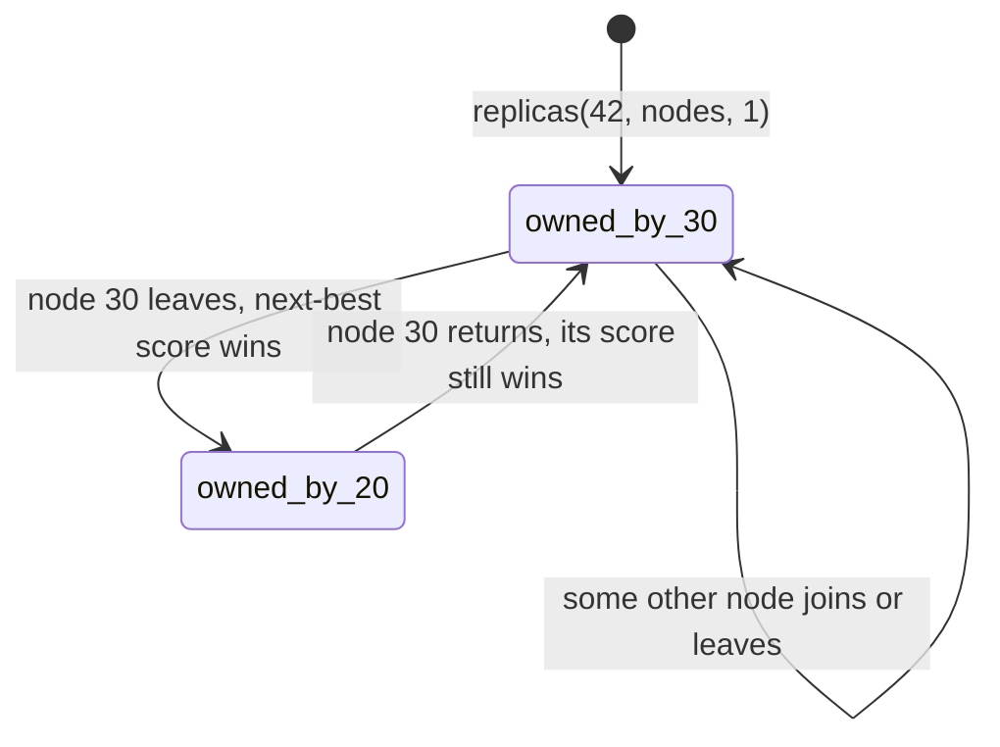
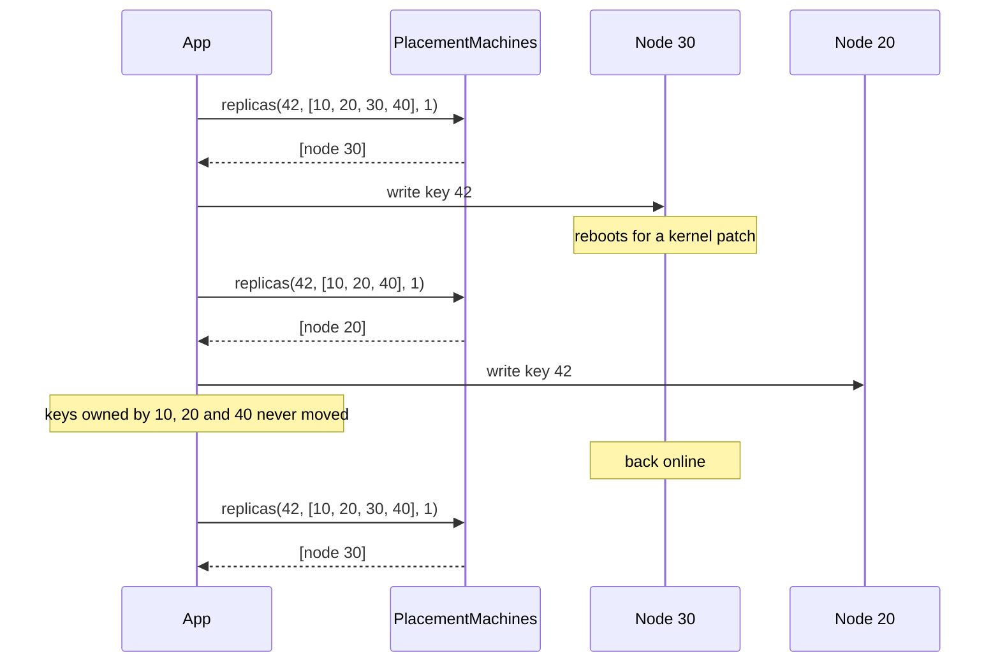

# PlacementMachines

> When one station goes dark, only its freight moves. 🧭

Consistent placement for Ruby. Give it a key and the list of nodes you have right now, and it tells you which node owns the key. Add a node, lose a node, ask again, and only the keys that belonged to the changed node get a new answer. Everything else stays exactly where it was. It can also pick three replicas spread across failure domains, and it can walk a hash ring if you already have one.

## Quick Start

```bash
gem 'placement_machines'
```

```ruby
Node = PlacementMachines::Node

# Node.new(id, failure_domain) for every node currently alive
nodes = [Node.new(10, 1), Node.new(20, 1), Node.new(30, 2), Node.new(40, 2)]

PlacementMachines.replicas(42, nodes, 1)   # => [Node(id: 30, domain: 2)]
PlacementMachines.replicas(42, nodes, 3)   # => [Node(id: 30, domain: 2), Node(id: 20, domain: 1)]
```

Node 30 owns key 42. If you want copies, the second goes to node 20, in a different domain. You asked for three and got two, because there are only two domains and the gem refuses to put two copies in the same one.

## A Message to the Resistance

So you sharded the cache. `node = nodes[key.hash % nodes.size]`. Four nodes, keys spread evenly, latency graphs flat, everyone goes home.

Then node 30 reboots for a kernel patch. `nodes.size` goes from 4 to 3. Every single key gets a new modulus, which means three out of four keys now point at a node that has never heard of them. The cache hit rate drops to the floor, the database behind it catches the full read load, and the on-call engineer learns what a thundering herd feels like at 2 AM. Over one node. That was patched. On purpose.

The fix is not a smarter modulus. The fix is to score every node for every key independently, so removing one node only disturbs the keys that scored highest on that node. Those keys move. Nothing else does. That is what this gem computes, and it does it the same way on every machine that asks, with no coordination and nothing to sync.

## Chapter 1: Stardate 2025.186, the AMS Karger

> **AMS Karger**, NCC-4213, *Karger*-class navigation tender.
> A missing station should not require redrawing the entire galaxy.

The tender holds no freight and commands no ships. It answers one question for any manifest and any list of stations: where does this go? Ask it on any bridge in the fleet with the same station list and you get the same answer. Strike a station from the list and the only manifests that get a new destination are the ones that were bound for it.

Somewhere in the fleet, a cadet proposes:

```ruby
def station_for(manifest)
  STATIONS[manifest.id % STATIONS.size]
end
```

"That," says the navigator, "is how one dark station reroutes the whole galaxy."

## The Flight Plan

Here is the life of one key:



And the night node 30 went down for a patch:



## How Placement Works

### Rendezvous

Every node gets a score for every key. Highest score owns the key. The score depends only on the key and the node id, never on who else is in the list. The owner is the first replica, so ask for one:

```ruby
Node  = PlacementMachines::Node
nodes = [Node.new(10, 1), Node.new(20, 1), Node.new(30, 2), Node.new(40, 2)]
owner = ->(key, list) { PlacementMachines.replicas(key, list, 1).first }

owner.(42, nodes).id                                 # => 30
owner.(42, nodes.reject { |node| node.id == 30 }).id # => 20
```

Node 30 drops out and key 42 goes to node 20, the runner-up. Measure it over a thousand keys and the point lands:

```ruby
before = nodes
after  = nodes.reject { |node| node.id == 30 }

moved       = (0...1000).count { |key| owner.(key, before) != owner.(key, after) }
owned_by_30 = (0...1000).count { |key| owner.(key, before).id == 30 }

moved == owned_by_30   # => true
```

Only node 30's keys moved. Compare that with `key % 4` becoming `key % 3`, which reassigns roughly three quarters of them.

The scores are available directly if you want to rank nodes yourself:

```ruby
PlacementMachines.score(42, 30)   # => a large Integer
PlacementMachines.score(42, 30) > PlacementMachines.score(42, 20)   # => true
```

Larger wins. Equal scores go to the lower node id, so there is never a tie.

### Replicas across failure domains

The second field of a node is its failure domain: a rack, an availability zone, a power circuit, whatever you don't want to lose twice. `replicas(key, nodes, limit)` answers at most `limit` nodes, highest score first, and skips any node whose domain is already represented.

```ruby
nodes = [Node.new(10, 1), Node.new(20, 1), Node.new(30, 2), Node.new(40, 2)]
PlacementMachines.replicas(42, nodes, 3).map(&:id)   # => [30, 20]

PlacementMachines.replicas(7, [Node.new(10, 1)], 3).map(&:id)   # => [10]
```

Two domains, two replicas. One node, one replica. The gem never pads the answer with a node that doesn't exist or a node that shares a domain with an earlier pick. A short answer is information: you are under-replicated, and `limit - answer.size` says by how much.

You get the whole `Node` back, domain included, so you never have to look up where a replica lives.

### The ring

If you already run a hash ring with virtual nodes, hand it the points. Each point is `RingPoint.new(position, node_id)`, in any order. The owner is the first point clockwise from the key, wrapping around at the top.

```ruby
RingPoint = PlacementMachines::RingPoint
ring = [RingPoint.new(100, 1), RingPoint.new(500, 2), RingPoint.new(900, 3)]

PlacementMachines.ring_owner(250, ring)   # => 2
PlacementMachines.ring_owner(500, ring)   # => 2, exact hit
PlacementMachines.ring_owner(950, ring)   # => 1, wrapped around
```

A node may appear at many positions. Two points on the same position go to the lower node id.

### Nothing to place

No nodes means no owner, not an error:

```ruby
PlacementMachines.replicas(1, [], 3)   # => []
PlacementMachines.ring_owner(1, [])    # => nil
```

### The same node twice

A membership that lists one node id twice is not a membership, and the gem will not guess which entry you meant. That is a refusal, and a refusal is a symbol, not an exception:

```ruby
PlacementMachines.replicas(1, [Node.new(1, 1), Node.new(1, 2)], 3)   # => :repeated_node
```

## The Rules of the Tender

- **Everything is an Integer** in `0..2**64-1`: keys, node ids, domains, ring positions, limits. Floats raise `TypeError`, negatives and overflow raise `RangeError`. Objects that merely respond to `to_int` are not integers.
- **Nodes are `PlacementMachines::Node` values** (`id`, `domain`), ring points are `PlacementMachines::RingPoint` values (`position`, `node`), the same fields in the same order as the core's structs. A bare Array pair, or anything else, raises `TypeError`.
- **Arguments are positional**, in the core's order. There are no keywords and no defaults: `limit` is the length of the core's output buffer, and you always say it.
- **Node ids are yours.** The gem issues no ids, so there is nothing to scope and nothing to restore after a restart. Nothing is stored between calls.
- **A refusal is a symbol, never an exception.** The same id twice in one list answers `:repeated_node`, even with different domains, whatever the limit.
- **No clock.** Nothing here is a time; no call reads or takes one.
- **Lists have ceilings.** At most 64 nodes (`MAX_NODES`) and 1024 ring points (`MAX_RING_POINTS`) per call. Over that raises `RangeError`.
- **Inputs are never touched.** Pass frozen arrays if you like. Results are fresh arrays you own.

### Every answer

A call that is honoured answers with a value. A call that is not honoured answers with a refusal symbol, the snake_case of the core's `Refusal` variant. There is no catch-all symbol.

| Call | Honoured | Refusals |
| --- | --- | --- |
| `score(key, node)` | `Integer` in `0..2**64-1` | none, a query |
| `replicas(key, nodes, limit)` | `Array` of at most `limit` `Node`s, best first, one per failure domain; shorter, or empty, when there are fewer domains | `:repeated_node` |
| `ring_owner(key, ring)` | `Integer` node id, or `nil` for an empty ring | none, a query |

## What You Think You're Doing vs Reality

### You Think: "Three replicas means I can lose two nodes."
### Reality: Three replicas on one rack means you can lose one power strip.

Spreading copies across nodes protects you from a node dying. It does nothing when the thing that dies is the rack, the zone, or the circuit all three nodes share. The domain is how you tell the placer what fails together. Give every node the same domain and `replicas` will honestly hand you one copy when you asked for three, because that is what you actually have.

## What's Yours

The placer decides where a key should live. It does not know which nodes are alive, so the list you pass in has to be your real, current membership, and every machine that calls it has to pass the same list or they will disagree. Moving data when ownership changes, repairing replicas, and choosing how keys and ring positions are hashed are all yours.

## License

MIT License. See [LICENSE.txt](LICENSE.txt) for details.

**Remember: `key % nodes.size` is not a placement strategy. It's a scheduled outage with extra steps.**
